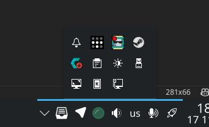
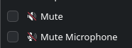

<p align="center">
  
</p>

# plasma-tweaks

KDE Plasma customizations with one CLI.

Instead of bundling static copies of KDE widgets, `plasma-tweaks` extracts the QML/config resources from your installed Plasma plugins at install/rebase time, applies targeted patches, validates the staged package, and publishes local overrides.

- `tray`: compact Windows-style system tray, small icons, names on hover, and an expand arrow on the left.
- `tray-hover` (optional, install separately): opens the tray popup when the pointer is over the expand arrow and closes it 400 ms after the pointer leaves, so you can move onto the icon box.
- `microphone`: microphone activity indicators and mute controls in Icons-only Task Manager.
- `launcher`: hides application labels in the Application Launcher favorites grid. With Icons-only Task Manager on the panel, the standard `Meta+1`–`Meta+9` shortcuts launch favorites by position while Kickoff is open. With Kickoff closed, those shortcuts activate taskbar entries.






## Requirements

- KDE Plasma 6 with `plasmashell` and `qtpaths6` (or `/usr/lib{,64}/qt6/bin/qtpaths`).
- One Qt 6 resource extractor backend (runs in a separate process loading only the trusted system `.so` plugin):
  - `PySide6` or `PyQt6` Python bindings (`python3-pyside6` / `python3-pyqt6`), **or**
  - The optional C++ helper in [helper/](helper/):
    ```sh
    cmake -S helper -B helper/build
    cmake --build helper/build
    ```
    Requires `Qt6Core` development headers and a C++17 compiler.

## Install

Run `./plasma-tweaks` in a terminal to open the patch menu. Use the arrow
keys to move, Space to toggle a patch, Enter to apply the selection, and
Esc or Q to cancel. Press R to toggle restarting Plasma after applying.
Installed patches start checked. Unchecking one removes it when you apply.

`all` installs `tray`, `microphone`, and `launcher` (opt-in features such as `tray-hover` are not included):

```sh
git clone https://github.com/dest4590/plasma-tweaks.git
cd plasma-tweaks
./plasma-tweaks install all --restart
```

Or install individual features:

```sh
./plasma-tweaks install tray --restart
./plasma-tweaks install tray-hover --restart
./plasma-tweaks install microphone --restart
./plasma-tweaks install launcher --restart
./plasma-tweaks status
./plasma-tweaks doctor
```

Run as your desktop user, without `sudo`. `--restart` restarts `plasma-plasmashell.service` (briefly hides the panel). Without it, files are staged and published, and take effect on next login.

## Update, Rebase, and Remove

```sh
./plasma-tweaks rebase --restart
./plasma-tweaks uninstall microphone --restart
./plasma-tweaks uninstall all --restart
```

- `rebase` rebuilds your `desired` features from the current system Plasma plugins (never enables new features).
- `doctor` is read-only: it reports detected Plasma/Qt6 paths, extractor backend, source artifact SHA-256 status, `desired`/`active`/`disabled` state, other systemd drop-ins, and pre-start hook coverage.
- `uninstall` restores the pre-installation backup (including any pre-existing user override or launcher symlink). If a pre-existing user override is restored, `plasma-tweaks` warns you to check its compatibility with your current Plasma version.

## How loading and update protection work

System Plasma applets (`org.kde.plasma.systemtray.so`, `org.kde.plasma.taskmanager.so`, and `org.kde.plasma.kickoff.so`) embed upstream QML in Qt resources (`:/qt/qml/plasma/applet/...`). To load the patched local QML from `$XDG_DATA_HOME/plasma/plasmoids/` instead of the embedded resources while still using the system C++ applet code, `plasma-tweaks` sets `X-Plasma-RootPath` to `org.local.icontray`, `org.local.taskmanager`, or `org.local.kickoff` and copies the system `.so` into `$XDG_DATA_HOME/plasma-tweaks-plugins/<pkg>/plasma/applets/org.local.<name>.so` exposed via `QT_PLUGIN_PATH`.

Both `$XDG_CONFIG_HOME/systemd/user/plasma-plasmashell.service.d/zz-plasma-tweaks.conf` and `~/.local/bin/plasmashell` invoke `plasma-tweaks preflight` before `plasmashell` starts:

- If source plugin/metadata SHA-256 hashes are unchanged, `preflight` exits immediately.
- If KDE was updated, `preflight` attempts to rebuild `desired` features from the new resources.
- If a package is incompatible with the new KDE resources, `preflight` disables only the affected override so the stock system widget is used and `plasmashell` still starts normally.

If your session does not use `plasma-plasmashell.service` and `~/.local/bin` is not ahead of `/usr/bin` in `PATH`, uninstall before upgrading Plasma and check `./plasma-tweaks doctor`.

## Adding a patch

Register each feature's applet and overlay directory in `package_catalog.py`.
A feature can contribute patches to more than one applet, as `launcher`
does for Kickoff and Icons-only Task Manager.

An overlay directory contains `patches.jsonc` and can include a `files/`
directory mirroring paths inside the applet package. Operations run in order
and require a unique match in the staged source. Use `replace` with `old`
and `new` for literal replacements. For `insert_before` and `insert_after`,
use `anchor` and a `lines` array to insert complete lines. An anchor can be
a string or an array of consecutive lines. Existing insertions using `text`
continue to use literal matching and concatenate exactly as written.

## Licensing

Original KDE copyright and SPDX notices are preserved. See [UPSTREAM.md](UPSTREAM.md) and `LICENSES/`. The CLI, helper, and patch/JS additions are GPL-2.0-or-later.
